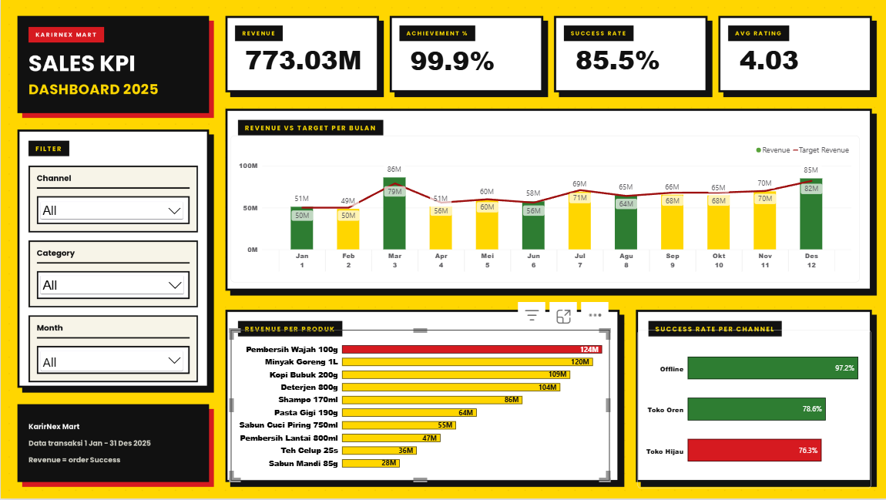
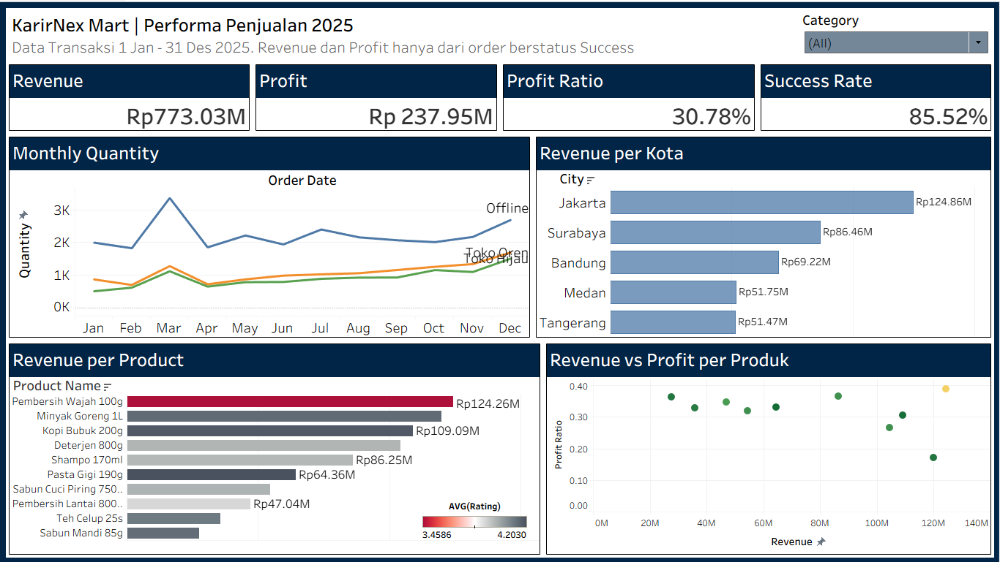
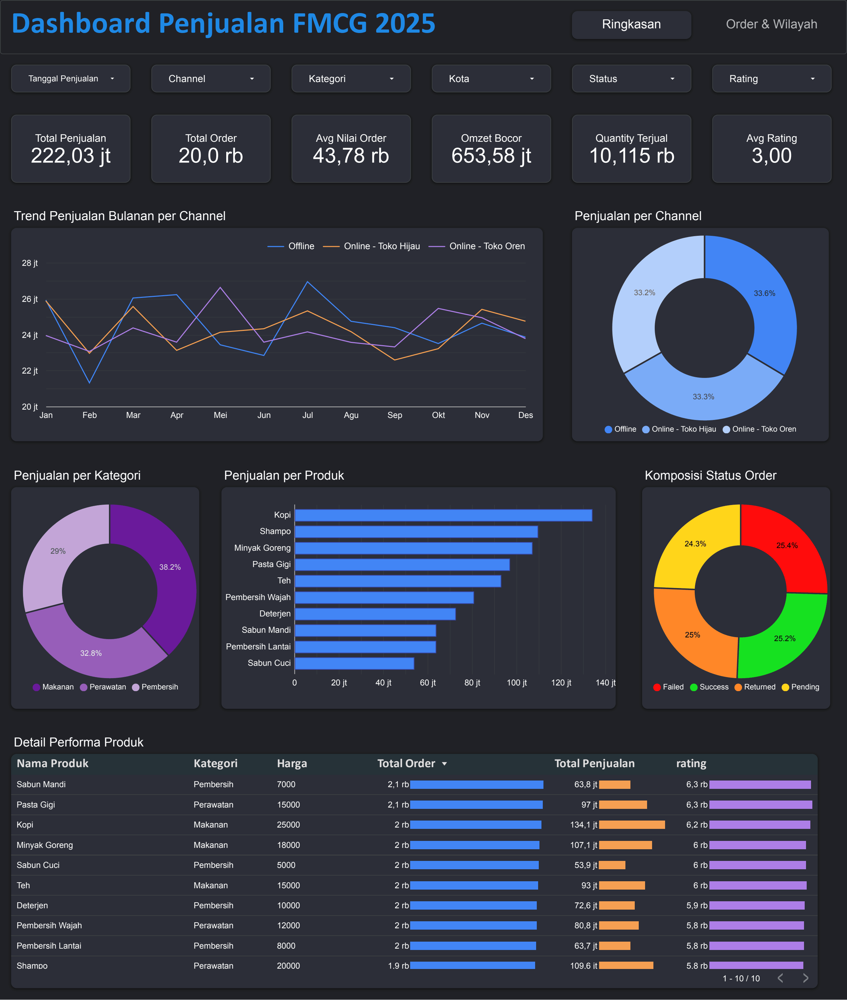
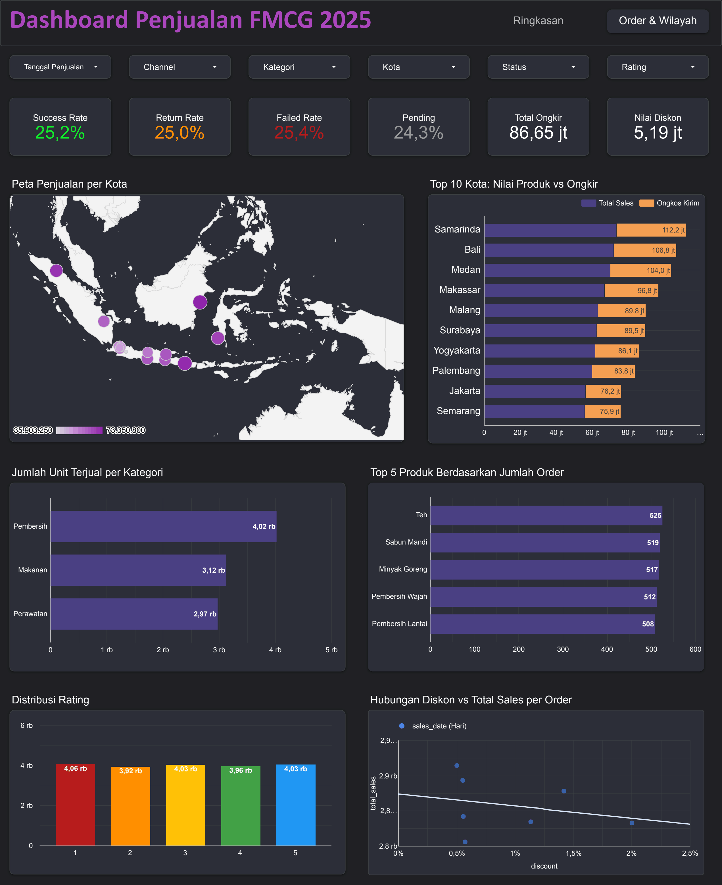
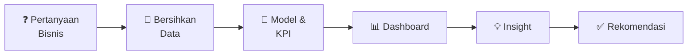

<div align="center">

# 🛒 KarirNex Mart Sales Performance 2025

### Data Visualization Portfolio: Power BI × Tableau × Looker Studio

*Mini Project | KarirNex Bootcamp Data Visualization | 29–31 Oktober 2026*


</div>

---


## 📌 Ringkasan

Repositori ini berisi **portofolio Data Visualization** dari bootcamp **Data Visualization: Power BI, Tableau, dan Google Looker Studio** bersama **KarirNex** (29–31 Oktober 2026).

Saya menganalisis data transaksi dummy toko FMCG **KarirNex Mart** tahun 2025 dan memfokuskan analisis pada satu pertanyaan bisnis: **bagaimana performa penjualan sepanjang 2025, dan di mana omzet serta keuntungannya bocor?**

Hasilnya adalah tiga dashboard interaktif, masing-masing dibuat dengan tool berbeda, yang mengubah sekitar 20.000 order transaksi menjadi gambaran yang mudah dibaca oleh pengambil keputusan.

<div align="center">

| Tool | Pertanyaan yang dijawab |
|---|---|
| **Power BI** | Apakah penjualan mencapai target? Bulan dan channel mana yang tertinggal? |
| **Tableau** | Produk mana yang laris tetapi tidak untung? |
| **Looker Studio** | Di mana order gagal dan bagaimana pola wilayah, ongkir, dan diskon? |

</div>
---

## 📈 1. Power BI | Sales KPI Dashboard



**Temuan utama**
- 🎯 Revenue Rp773,03 juta hampir menyentuh target (**99,9%**), tetapi hanya **5 dari 12 bulan** yang mencapai target.
- 🏆 Maret adalah bulan terbaik (Rp86 juta). Produk terbesar adalah **Pembersih Wajah 100g** (Rp124 juta).
- 🏬 Success rate **Offline 97,2%**, jauh di atas Toko Oren (78,6%) dan Toko Hijau (76,3%).

---

## 📖 2. Tableau | Cerita di Balik Angka



[](https://public.tableau.com/shared/R4DYPW536?:display_count=n&:origin=viz_share_link)

> **Penjualan besar belum tentu untung besar.**

| Babak | Isi cerita |
|---|---|
| 🌱 **Konteks** | Revenue Rp773,03M, profit Rp237,95M (rasio **30,78%**). Jakarta memimpin dengan Rp124,86M. |
| ⚡ **Konflik** | **Minyak Goreng 1L** terlaris kedua, tetapi profit ratio hanya **17,1%** (terendah). **Pembersih Wajah** revenue #1 dan margin tertinggi (38,8%), tetapi rating terendah (**3,46**) dan return **8,1%**. |
| 💡 **Resolusi** | Naikkan harga atau bundling Minyak Goreng, audit kualitas Pembersih Wajah, dan benahi proses channel online. |

---

## 🧭 3. Looker Studio | Dashboard Penjualan FMCG

| Ringkasan | Order & Wilayah |
|:---:|:---:|
|  |  |

[](https://datastudio.google.com/reporting/c7d674eb-14a8-41aa-bcf6-ce54c99dbba0)

**Temuan utama**
- 🚦 Dari 20.000 order, hanya **25,2% berstatus Success**. Returned, Failed, dan Pending masing-masing sekitar 25%.
- 🧴 **Pembersih** unggul dalam jumlah unit, sedangkan **Makanan** unggul dalam nilai penjualan.
- 🏷️ Diskon hanya ada di dua level (0% dan 15%), jadi pengaruhnya belum bisa disimpulkan.

---

## 🛠️ Alur Kerja & Skill




## 🗂️ Dataset & Catatan Data

Seluruh dataset adalah **data dummy dari bootcamp**, sengaja dibiarkan apa adanya dan **tidak untuk dibandingkan satu sama lain**.

| Hari | File | Baris | Keterangan |
|---|---|---:|---|
| 1 | `Dataset_PowerBI_KarirNexMart_2025_Day_1.xlsx` | 20.162 | Data mentah (kotor), 3 sheet: Sales, Products, Bulan_Target |
| 2 | `Dataset_Tableau_KarirNexMart_2025_Day_2.xlsx` | 20.012 | Order yang sama dengan Day 1, sudah bersih, dengan `Unit Cost` |
| 3 | `Data_FMCG_BT_Data_Analyst_Day_3.xlsx` | 20.000 | Dataset berbeda (produk dan harga berbeda) |

<details>
<summary><b>🔍 Catatan kualitas data (klik untuk membuka)</b></summary>

<br>

- **Day 1:** terdapat 150 `order_id` duplikat serta penulisan `status` dan `city` yang tidak seragam (`success`/`SUCCESS`, `jakarta`/`JAKARTA`). Setelah duplikat dihapus, tersisa 20.012 order.
- **Day 1 dan 2:** kolom rating kosong di sekitar 37% baris. Rata-rata rating dihitung dari baris yang terisi.
- **Day 3:** distribusi status dan rating tampak acak, sehingga *success rate* 25% **bukan** temuan bisnis dan tidak sebanding dengan 85,5% pada Day 1 dan 2.

</details>

<details>
<summary><b>📐 Definisi metrik (klik untuk membuka)</b></summary>

<br>

- **Revenue** = `Quantity × Unit Price × (1 − Discount)`, hanya order **Success**.
- **Profit** = Revenue − `Quantity × Unit Cost`, hanya order Success.
- **Success Rate** = order Success ÷ seluruh order.
- **Looker Studio:** Total Penjualan, Total Ongkir, dan Quantity Terjual hanya menghitung order Success. Total Order, Avg Nilai Order, dan Nilai Diskon menghitung semua status.

</details>

---

## 📁 Struktur Repositori

```
karirnex-mart-dataviz/
├── assets/     
├── data/   
├── powerbi/    
├── tableau/
└── README.md
```

---

## ⚠️ Keterbatasan

- Data bersifat dummy, bukan data bisnis nyata.
- Rekomendasi bersifat hipotesis dan perlu divalidasi sebelum diterapkan.
- Hubungan diskon dengan penjualan adalah korelasi, bukan sebab-akibat.

---

## 👤 Penulis

**Yudha Alfarizi** | Peserta Bootcamp Data Visualization KarirNex

[](https://www.linkedin.com/in/yudha-alfarizi))

---
<div align="center">

🙏 Terima kasih kepada **KarirNex** dan para mentor atas bimbingan selama bootcamp.

⭐ Jika portofolio ini bermanfaat, beri bintang pada repositori ini.

</div>
